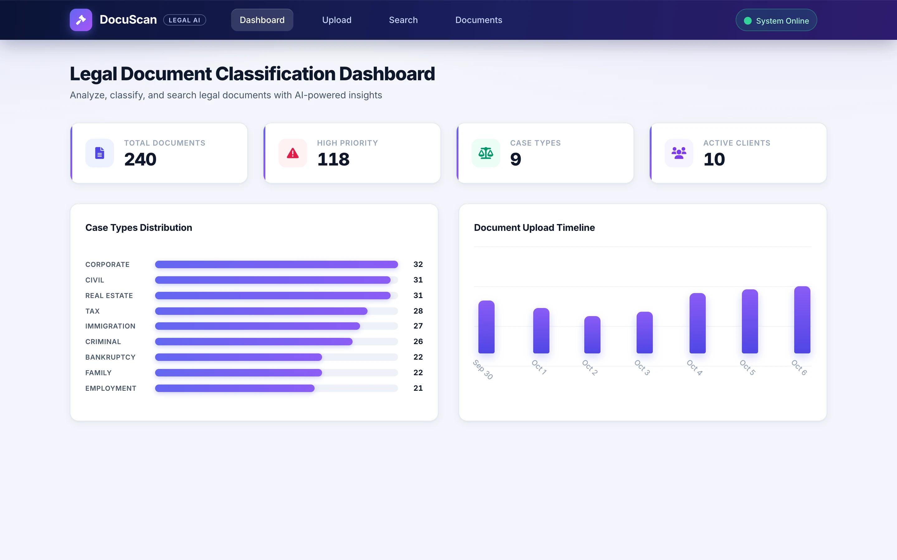
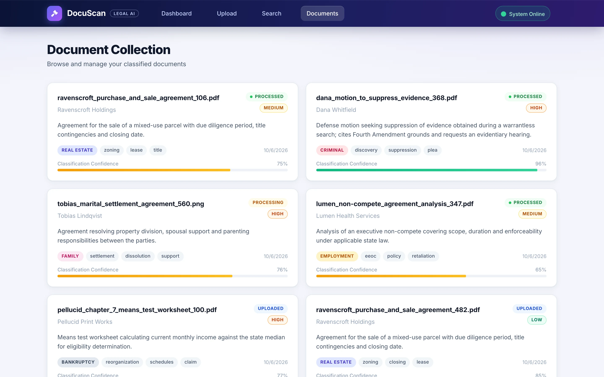
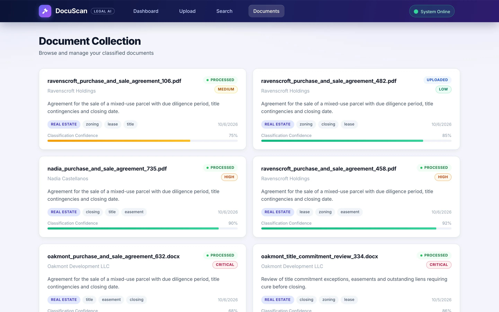
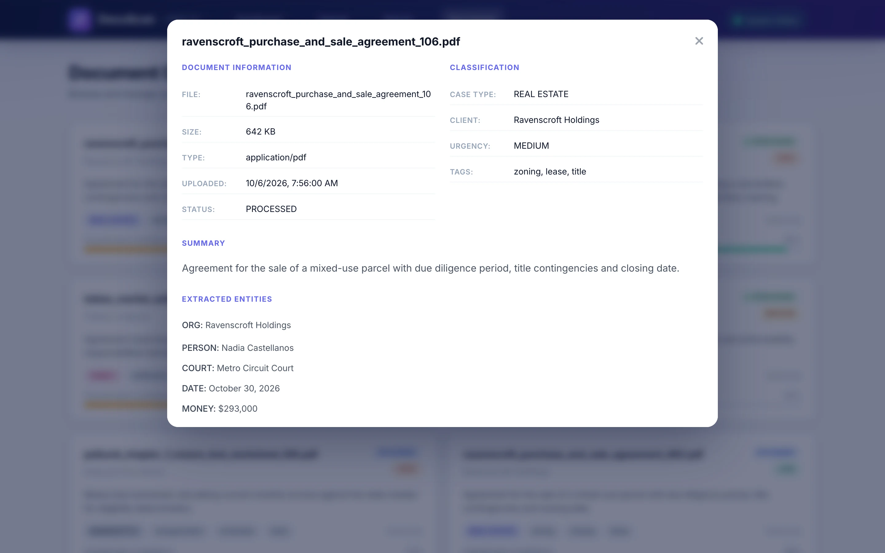
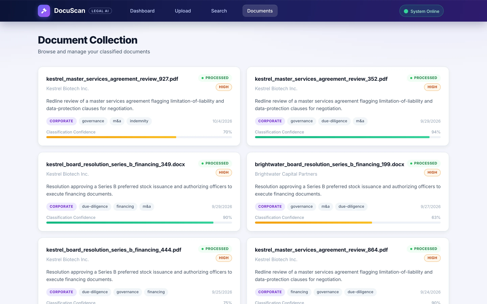
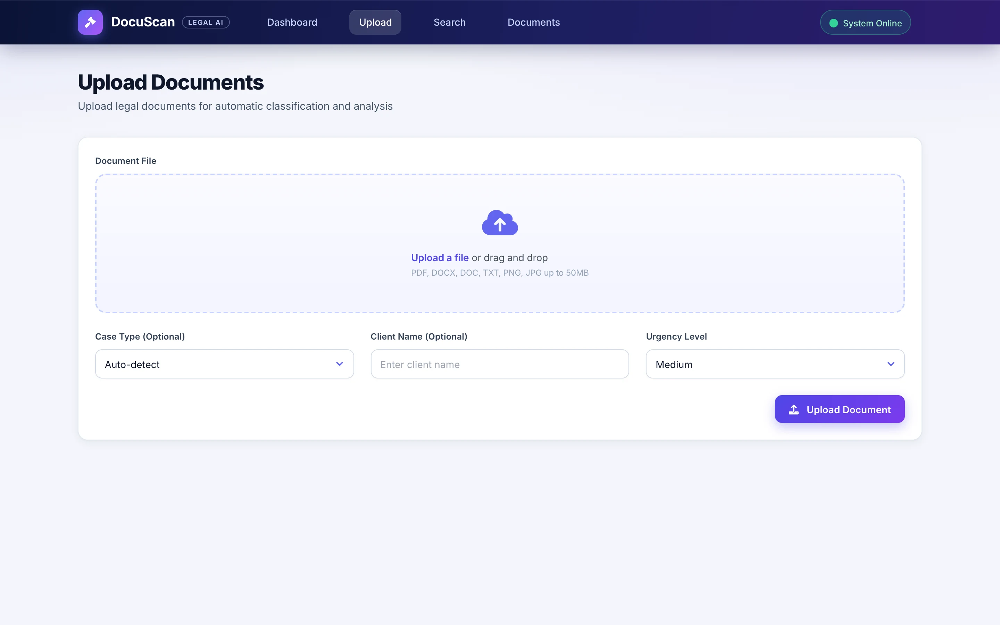

# Docu-Scan

**A legal document classification and search system: OCR intake, NLP tagging by case type and urgency, full-text search, and a dashboard.**

**Web application** 
FastAPI · spaCy · Tesseract · Elasticsearch · Vanilla JS · Docker Compose

<table>
  <tr>
    <td></td>
    <td></td>
  </tr>
</table>
Screenshots are real captures of a local build running on fictional demo data.

---

## Product at a Glance

| | |
|---|---|
| **What it is** | Intake and search tool that classifies legal documents by case type and urgency |
| **Inputs** | PDF, Word and image uploads with optional case, client and urgency hints |
| **Classification** | Rule-based and statistical (keyword weighting, TF-IDF) with confidence scores; spaCy entity extraction |
| **Search** | Full-text search with case-type and urgency filters |
| **Export** | CSV and JSON export of search results |
| **Frontend** | Static HTML and vanilla JavaScript with Tailwind CSS |
| **Backend** | FastAPI with Pydantic models, Elasticsearch index, Redis, Docker Compose services |

## Product Showcase

<table>
  <tr>
    <td align="center"> <b>Search results</b> Keyword plus case-type filter</td>
    <td align="center"> <b>Document detail</b> Classification, summary, entities</td>
    <td align="center"> <b>Filtered view</b> Corporate, high urgency</td>
  </tr>
  <tr>
    <td align="center"> <b>Upload</b> Drag and drop with metadata hints</td>
  </tr>
</table>

## Key Features

- Drag-and-drop upload with case type, client and urgency hints
- Tesseract OCR service for scans and images, plus PyPDF2 and python-docx for native files
- spaCy entity extraction (people, organizations, dates and similar) and tag extraction
- Case-type and urgency classification with confidence scores and an extractive summary
- Full-text search with case-type and urgency filters
- Dashboard with KPI cards, case-type distribution and upload timeline
- Document cards and a detail view with entities and summary
- CSV and JSON export

## Architecture

Upload, OCR, NLP classification, Elasticsearch indexing, then a versioned `/api/v1` API feeding a static frontend. OCR, NLP, document and Elasticsearch logic live in separate services. Docker Compose defines Elasticsearch, Redis, backend, frontend and nginx. See [docs/ARCHITECTURE.md](docs/ARCHITECTURE.md).

## Engineering Highlights

- Service split between OCR, NLP, document and search layers
- Typed Pydantic models and enums for case types and urgency levels
- Generic `SuccessResponse` wrappers and health, readiness and liveness endpoints
- Transparent classification: keyword and TF-IDF scoring with visible confidence
- Export routes and a batch-processing route
- Compose stack with health checks

## Status & Scope

- The screenshots come from a demo mode: a small stand-in API serves 240 fictional, seeded documents to the unmodified frontend.
- spaCy, Tesseract and Elasticsearch were not running in the demo, and the full Docker stack could not be started locally. The OCR and NLP code is implemented but was not exercised in these captures.
- Classification is rule-based and statistical, not an LLM or trained model. Transformers and torch appear in the requirements but are not used.
- Uploads are disabled in the demo, so the upload screen is shown as a static form.
- The original frontend and backend API contracts do not fully match; the demo bridges this. The visual styling in the screenshots is applied at serve time for the demo.

## Documentation

- [Product overview](docs/PRODUCT_OVERVIEW.md)
- [Architecture](docs/ARCHITECTURE.md)
- [Technical case study](docs/TECHNICAL_CASE_STUDY.md)
- [Engineering challenges](docs/ENGINEERING_CHALLENGES.md)
- [Privacy and source](docs/PRIVACY_AND_SOURCE.md)

Rights and usage: see [RIGHTS.md](RIGHTS.md).
