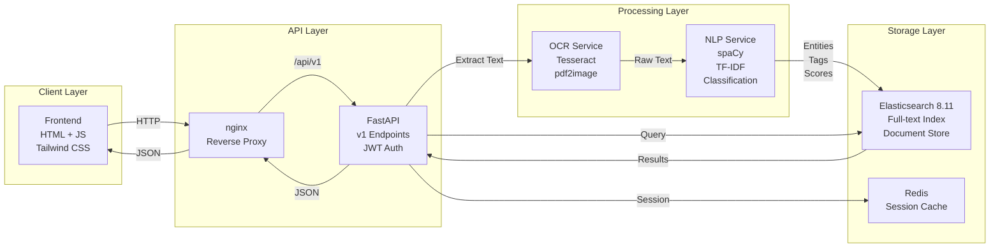

# Architecture

## System Overview

Docu-Scan follows a layered pipeline architecture: intake → text extraction → NLP processing → search indexing → API query interface → frontend presentation. Each processing stage is decoupled into independent services.

## Data Flow

1. **Upload** – Client sends document + metadata via `/api/v1/documents` POST
2. **OCR** – Document binary → text extraction (Tesseract; pdf2image for PDFs)
3. **NLP Classification** – Text → entity extraction (spaCy) + case-type/urgency scoring (TF-IDF, keyword weights) + summary
4. **Elasticsearch Indexing** – Classified document indexed with extracted entities, tags, confidence, and raw text
5. **Search Query** – Client queries `/api/v1/documents/search` with filters (case type, urgency, free text)
6. **Results** – ES returns ranked documents; API wraps in SuccessResponse JSON and serves to UI
7. **Export** – Client requests CSV/JSON; backend iterates results and streams formatted output

## Service Isolation

- **OCR Service** (`backend/services/ocr_service.py`) – Orchestrates text extraction from multiple formats
- **NLP Service** (`backend/services/nlp_service.py`) – Runs entity extraction, classification, and summarization
- **Document Service** (`backend/services/document_service.py`) – CRUD and business logic
- **Elasticsearch Adapter** – Direct ES client wrapper for indexing and querying
- **FastAPI Routes** – HTTP layer; validates input, calls services, returns SuccessResponse wrappers

## Authentication and Security

The backend includes JWT authentication routes (python-jose/passlib, HTTP Bearer scheme). The static frontend itself has no login screen, and the demo runs without authentication.

## Containerization

Docker Compose defines five services: `elasticsearch`, `redis`, `backend`, `frontend`, and `nginx`. Health checks monitor Elasticsearch and backend readiness. The frontend service is a static file server (nginx). The backend service is the FastAPI app, exposed behind an nginx reverse proxy.
